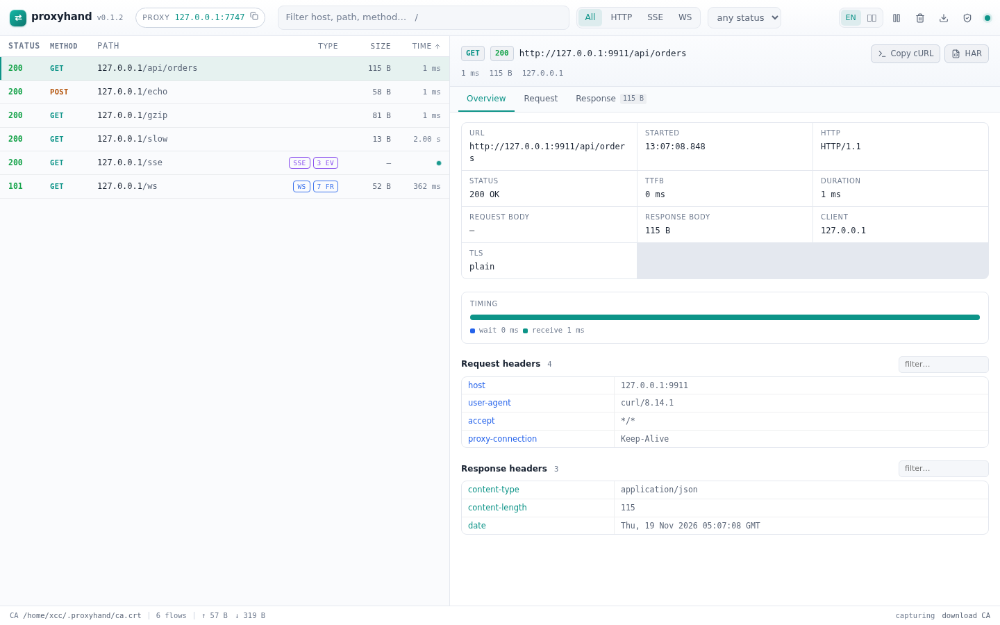
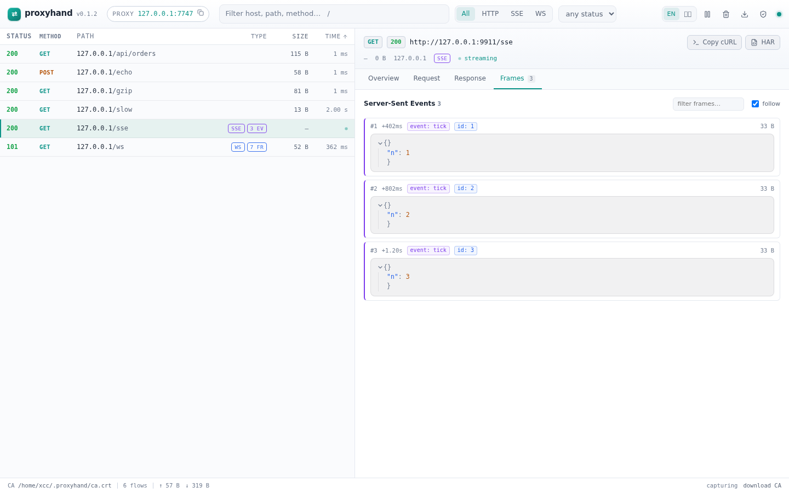
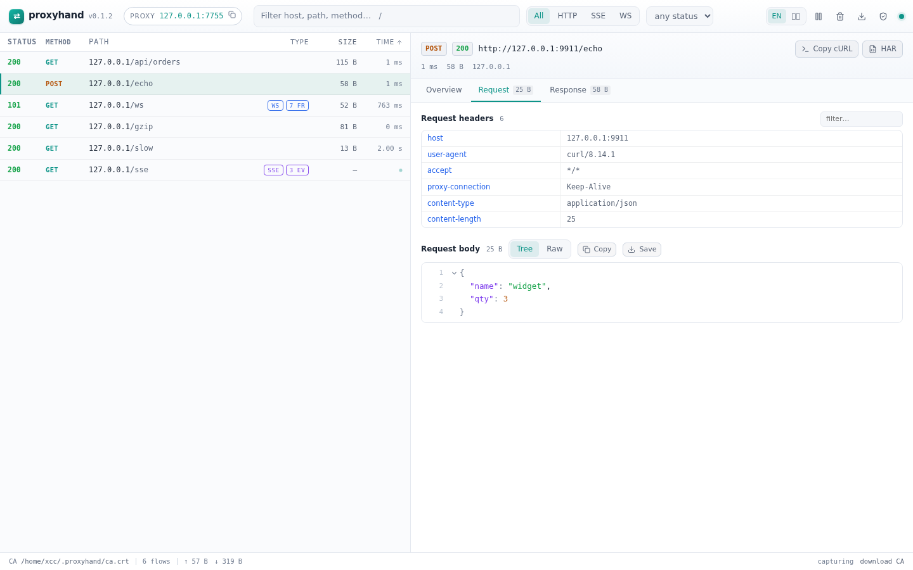
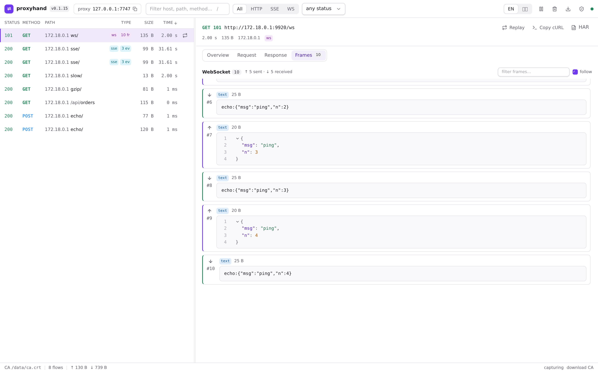
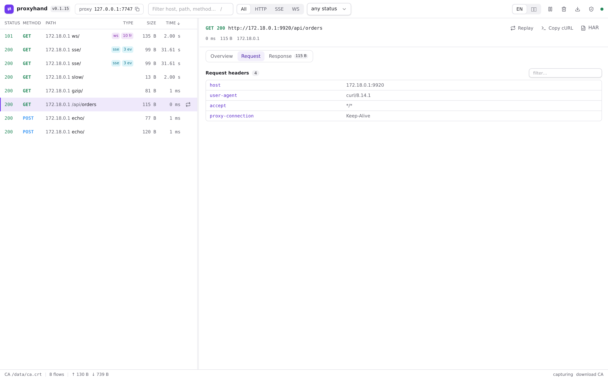
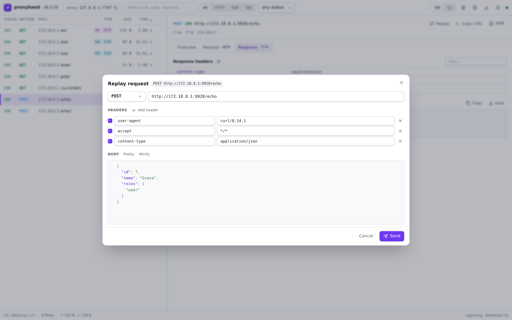
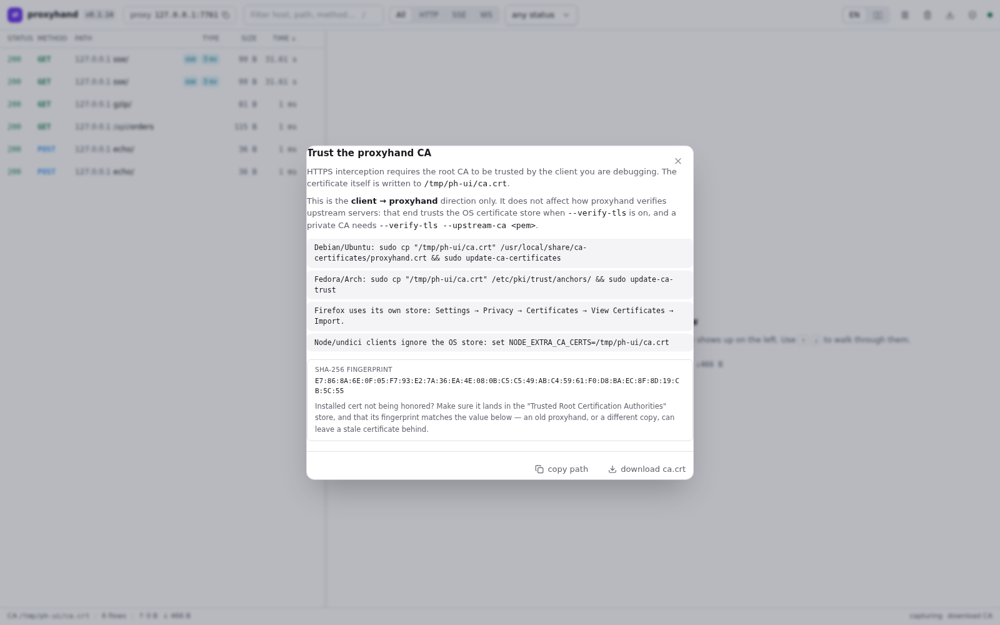

# proxyhand

**A single-binary HTTP/HTTPS/SSE/WebSocket interception proxy with a built-in web UI.**

One process, one port for both `http://` and `https://`, certificates minted on the fly, and a light
inspector that streams SSE events and WebSocket frames as they happen instead of dumping a buffered blob.
Written in Rust, so it ships as one static binary — nothing to install alongside it.

[](https://github.com/xiegoudan/proxyhand/releases/latest)
[](https://hub.docker.com/r/xiegoudan/proxyhand)
[](LICENSE)

```
┌───────────────┐   HTTP/HTTPS/WS   ┌────────────────────┐    ┌──────────────┐
│ browser / app │ ────────────────► │     proxyhand      │ ─► │   upstream   │
└───────────────┘      :7747        │  proxy + web UI    │    └──────────────┘
                                    │       :7747        │
                                    └────────────────────┘
                                            ▲
                    http://127.0.0.1:7747 ──┘   (same port: requests addressed to it are the UI)
```

English | [简体中文](README.zh-CN.md)

### Screenshots

| | |
| --- | --- |
|  |  |
|  |  |
|  |  |

## Quick start

```bash
git clone git@github.com:xiegoudan/proxyhand.git
cd proxyhand
cargo build --release
./target/release/proxyhand        # proxy + UI on http://127.0.0.1:7747
```

Or install it from source: `cargo install --path .`.

The web UI is embedded in the binary, so there is nothing else to run. Open
<http://127.0.0.1:7747> — the proxy serves the UI itself, on the same port it proxies on.

The prebuilt bundle (`web/dist/index.html`) is committed, so a plain `cargo build` already has a UI.
If you edit `web/src/`, rebuild it with `pnpm build:web` — `build.rs` re-embeds it on the next `cargo build`.

Try it against the bundled demo target:

```bash
cargo run --release --example demo-target      # http://127.0.0.1:9911 with JSON, SSE and a WS echo
curl -x http://127.0.0.1:7747 http://127.0.0.1:9911/api/orders
curl -x http://127.0.0.1:7747 -N http://127.0.0.1:9911/sse
```

Point a client at it:

```bash
export HTTP_PROXY=http://127.0.0.1:7747 HTTPS_PROXY=http://127.0.0.1:7747 NO_PROXY=localhost,127.0.0.1
curl -x http://127.0.0.1:7747 https://example.com
```

## Prebuilt binaries

Every release attaches the executables themselves — nothing to unpack — named
`proxyhand-<arch>-<system>`. `amd64` means x86-64 (every ordinary Intel/AMD PC),
`arm64` means 64-bit ARM (Apple silicon, Windows on ARM, ARM servers):

| Platform | Asset |
| --- | --- |
| Windows x64 | `proxyhand-amd64-windows.exe` |
| Windows on ARM | `proxyhand-arm64-windows.exe` |
| Linux x64, static | `proxyhand-amd64-linux` |
| Linux arm64, static | `proxyhand-arm64-linux` |
| macOS Apple silicon | `proxyhand-arm64-macos` |
| macOS Intel | `proxyhand-amd64-macos` |
| Debian / Ubuntu | `proxyhand-<version>-amd64.deb`, `proxyhand-<version>-arm64.deb` |
| Fedora / RHEL / openSUSE | `proxyhand-<version>-amd64.rpm`, `proxyhand-<version>-arm64.rpm` |

The Linux binaries are statically linked, so the same file runs on every distribution — including Alpine,
older glibc and minimal containers.

```bash
curl -LO https://github.com/xiegoudan/proxyhand/releases/latest/download/proxyhand-amd64-linux
chmod +x proxyhand-amd64-linux
sudo mv proxyhand-amd64-linux /usr/local/bin/proxyhand

sudo dpkg -i proxyhand-0.1.0-amd64.deb            # Debian / Ubuntu
sudo rpm -U proxyhand-0.1.0-amd64.rpm             # Fedora / RHEL / openSUSE
```

Releases are cut by `.github/workflows/release.yml` on every `v*` tag; `SHA256SUMS` is attached as well.

## Trust the CA (needed for HTTPS)

The root CA lives in `~/.proxyhand/ca.crt` (delete the directory to regenerate). Leaf certificates are minted per
SNI hostname on demand. Install the CA wherever your client keeps trust:

| platform | command |
| --- | --- |
| Windows (admin) | `certutil -addstore -f "ROOT" ca.crt` |
| Debian/Ubuntu/WSL | `sudo cp ca.crt /usr/local/share/ca-certificates/proxyhand.crt && sudo update-ca-certificates` |
| Fedora/Arch | `sudo cp ca.crt /etc/pki/trust/anchors/ && sudo update-ca-trust` |
| macOS | `sudo security add-trusted-cert -d -r trustRoot -k /Library/Keychains/System.keychain ca.crt` |
| Firefox | Settings → Privacy & Security → Certificates → Authorities → Import |
| Node.js | `NODE_EXTRA_CA_CERTS=~/.proxyhand/ca.crt` (undici/fetch ignore the OS store) |
| curl | `--cacert ~/.proxyhand/ca.crt` or `-k` |

The shield button in the UI toolbar shows the same instructions and a download link (`/api/ca.crt`):


`proxyhand --help`, the startup banner and `/api/trust` all carry these instructions, in English or Chinese.

### Two different trust directions

This trips people up, because the same word covers both ends of the proxy:

- **your client → proxyhand** — solved by the table above. Installing `ca.crt` is what lets the browser or app accept
  the certificates proxyhand mints on the fly. It says nothing about how proxyhand treats servers.
- **proxyhand → upstream server** — an unrelated question, about the *server's* certificate (a corporate MITM box, a
  self-signed dev host…). This is where the "upstream certificate was not verified" note comes from.

The two ends are configured separately; adding proxyhand's own CA to "Trusted Root Certification Authorities" only
affects the first. For the second end, the note is honest: it appears only when verification was actually attempted,
failed, and the request was retried insecurely — and it names the TLS error instead of tagging every HTTPS flow.

`--verify-tls` trusts what a browser trusts: the bundled roots **plus the OS certificate store** (Windows ROOT, macOS
Keychain, `/etc/ssl/certs`). A corporate CA that is already installed system-wide needs no extra flags. When the CA
is in neither place, add it explicitly:

```bash
proxyhand --verify-tls --upstream-ca corp-root.pem --upstream-ca another.pem   # repeatable
proxyhand --verify-tls --no-system-ca --upstream-ca corp-root.pem              # only the bundled roots + these PEMs
```

With verification off (the default) no check is attempted and nothing is reported.

## Usage

```
proxyhand [options]

-p, --port <n>        proxy port (default 7747; HTTP, HTTPS and the web UI share it)
-h, --host <addr>     listen address (default 127.0.0.1; use 0.0.0.0 to capture a phone)
-d, --dir <path>      data dir for the root CA (default ~/.proxyhand)
    --no-ui           headless: proxy only, no web UI and no /api endpoints
    --verify-tls      verify upstream certificates (default: accept anything, debug-friendly);
                      also trusts the OS certificate store, like a browser
    --no-system-ca    with --verify-tls, use only the bundled roots (skip the OS store)
    --upstream-ca <p> PEM file with extra CA(s) trusted for upstream TLS; repeatable, additive to
                      the bundled roots and the OS store. Only matters with --verify-tls
    --max-flows <n>   flows kept in memory (default 3000, oldest finished evicted)
    --max-body <n>    bytes kept per body (default 8 MiB, after decompression)
    --self-hosts <l>  extra names that also mean "this proxy" (comma separated); the built-in list is
                      localhost, 127.0.0.1, ::1, 0.0.0.0, the hostname and the interface IPs
    --lang <en|zh>    UI/CLI language (default: PROXYHAND_LANG, then LANG/LC_ALL, then English)
-v, --verbose         log every request
-V, --version         print the version
    --help            print this help
```

### One port for everything

The listen port does three jobs at once: plain HTTP proxying (absolute-form requests), HTTPS via `CONNECT` + MITM,
and the web UI itself. A request is answered by the UI when its host is one of this machine's addresses and its port
is ours — so opening <http://127.0.0.1:7747> works whether or not the browser is pointed at the proxy, and those UI
requests never show up in the flow list. An alias hostname that resolves here but is not recognised is forwarded once
with a marker header and answered with `508` instead of looping — add it with `--self-hosts`.

For a phone, start with `--host 0.0.0.0`, set the device WiFi proxy to `<machine-ip>:7747`, and install `ca.crt` on
the device.

### Docker

Published on Docker Hub for `linux/amd64` and `linux/arm64` (one tag, both architectures):

```bash
docker pull xiegoudan/proxyhand:latest
docker run --rm -p 8899:7747 -v proxyhand_data:/data xiegoudan/proxyhand:latest

docker build -t proxyhand .          # or build it yourself
docker run --rm -p 8899:7747 -v proxyhand_data:/data proxyhand
```

The container listens on the default port **7747**, so publish whatever host port you like — `-p 8899:7747`
keeps the old URL working. The UI answers on any host port you type, because a browser pointed at the proxy
sends a plain path and the proxy recognises its own hostnames; `-p 8900:7747` works just as well.

The root CA lives on the volume (`/data/ca.crt` survives rebuilds). `--self-hosts proxy` is baked in so a
container with `HTTP_PROXY=http://proxy:7747` can still `GET http://proxy:7747/api/ca.crt` to install the CA
(otherwise that request would bounce off the loop guard with `508`).

If `ca.crt` and `ca.key` already exist in `--dir`, they are reused instead of a new root being minted — the
keys may be PEM in any common encoding, PKCS#8 or PKCS#1 (`RSA PRIVATE KEY`) alike. That is what keeps
clients that already trust the CA working across upgrades and restarts.

```bash
docker compose build proxy && docker compose up -d proxy   # reuses the proxyhand_data volume
```

```yaml
proxy:
  build: { context: . }
  ports: ["8899:7747"]
  volumes: [proxyhand_data:/data]
```

## What the UI does

- **Live flow list** with method, status, duration, size, and `SSE` / `WS` / `tunnel` badges, plus filters (text,
  kind, status) and keyboard walk-through (`↑` `↓`, `/` to search, `Esc` to deselect).
- **Chronological order by default** — new flows land at the bottom and the list follows them while you stay at the
  bottom. Click the **Time** column header (or press `o`) for newest-first; the choice is remembered.
- **Overview**: timings (TTFB vs receive), byte counts, ALPN, proxy notes, both header tables.
- **Request / Response**: headers with filter, bodies as a line-numbered JSON tree (Yaak-style: collapsed branches,
  syntax colours, wrapped long values) that starts fully expanded (or raw), one click to copy the whole body,
  gzip/br/deflate decoded on the fly, binary bodies downloadable, truncation flagged.
- **Form bodies** (`application/x-www-form-urlencoded`, `multipart/form-data`) as a field table instead of raw text —
  file parts keep their name, content type and size, and every field can be copied with one click.
- **SSE**: every event individually — `event:`, `id:`, `retry:`, comments, byte size, arrival offset, JSON payload in
  a tree, follow-tail toggle, frame filter.
- **WS**: both directions interleaved with `↑` / `↓`, opcode (text/binary/ping/pong/close), fragmentation and
  truncation flags, JSON payload tree.
- **Replay** any request: edit the method, URL, headers and body in a dialog and send it again through the proxy
  (same TLS path, same capture). The new flow appears in the list and is selected for you.
- **Images shown inline**: an `image/*` response body renders as the picture itself (PNG/JPEG/WebP/GIF from the
  captured bytes, SVG from its text), with the mime type and size as a caption — no base64 squinting.
- **Copy cURL** for any flow, **HAR export** for one flow or everything, **pause / clear** capture — clearing
  drops the finished flows and leaves the streams that are still open.
- **English / 简体中文** switch in the header (`?lang=`), remembered in `localStorage`.

## How it works

| file | role |
| --- | --- |
| `src/proxy.rs` | One `TcpListener`; hyper serves absolute-form requests and `CONNECT`. A first-byte `0x16` check decides MITM vs raw tunnel. TLS is terminated with rustls and per-SNI leaf certs; ALPN is pinned to `http/1.1`. Bodies are tees: forwarded bytes are untouched, parsers only observe copies. CONNECT tunnels are handed to a worker task so the service future stays `Send`. |
| `src/ca.rs` | Root CA (rcgen, ECDSA P-256) + cached per-host leaf certificates, 397-day leaves with `subjectAltName` (IP SANs included), trust instructions per platform. |
| `src/tls.rs` | Upstream client configs: a verifying one (bundled roots + OS store + `--upstream-ca`) and a fail-open one used when verification is off or after exactly one failed attempt. |
| `src/sse.rs` | Incremental `text/event-stream` parser (`\r\n` / `\n` / `\r`, multi-line `data:`, comments, `retry:`), plus an NDJSON line splitter. |
| `src/ws.rs` | Passive RFC 6455 frame parser: masking, 126/127 length forms, continuation and close codes. The proxy never re-encodes frames; the same bytes reach both peers. |
| `src/store.rs` | In-memory ring of flows (default 3000) + a broadcast channel; frame arrays capped at 20k per flow. Notes are stored structurally and localized when a flow is rendered. |
| `src/api.rs` | REST (`/api/state`, `/api/flows`, `/api/flows/:id`, `/api/pause`, `/api/export/har`, `/api/ca.crt`, `/api/trust`) + `/ws` push channel + hosting of the embedded UI. |
| `src/har.rs` | HAR 1.2 export (timings, decoded bodies, base64 for binary). |
| `src/util.rs` | Target resolution (absolute-form URI vs `Host`), body decoding/truncation, hop-by-hop handling. |
| `web/` | React 19 + Vite UI, bundled with `vite-plugin-singlefile`; `build.rs` embeds `web/dist/index.html` into the binary. |

Design notes:

- **Rust, one binary.** TLS interception needs a per-SNI certificate hook: rustls gives exactly that, and the result
  is a static binary with no runtime to install. HTTP/1.1 only, which is what debugging proxies need most of the time.
- **Fail-open TLS verification.** Upstream certs are not verified by default (like Charles/whistle) so self-signed dev
  servers work; pass `--verify-tls` to enforce. A verification failure triggers exactly one insecure retry and a note
  on the flow — never a silent per-request fallback, and no note at all when nothing was verified.
- **No 20s body clock.** One socket timeout cannot serve both a JSON call and an SSE stream, so headers are bounded
  (30s: connect, handshake and response headers) separately from bodies. Streams are never reaped for being quiet;
  ordinary bodies are reclaimed after 120s of inactivity.
- **Resolution cached, IPv4 first.** A browser opens dozens of connections per page, so a hostname is resolved once and
  the answer reused for 60s; failed lookups are remembered for 5s instead of being retried in a storm. Addresses are
  tried IPv4 first with a 3s bound each, so an unreachable AAAA record costs three seconds once, not thirty every time.
- **No buffering.** SSE frame parsing happens on the same chunks that are forwarded, so long-lived streams appear
  incrementally and keep-alives stay intact. Response compression is decoded only for the recorded copy.
- **Bounded memory.** Every capture is capped: `--max-body` per body (with truncation flagged and the dropped byte
  count kept), 20k frames per flow, `--max-flows` flows total.

## Limitations

- HTTP/1.1 only (ALPN is pinned; h2 is not proxied).
- WebSocket frames are observed, not editable; no breakpoints, no intercept/edit/replay yet.
- Non-TLS traffic on `CONNECT` is tunneled as-is and recorded as a `tunnel` flow (no inspection).
- Upstream HTTP/2, HTTP/3 and QUIC are not supported.
- Request bodies are buffered in memory to make the verification retry safe (cap: 64 MiB).

## Troubleshooting

- **`curl: (35) schannel: ... CRYPT_E_NO_REVOCATION_CHECK` on Windows.**
  Windows' bundled curl uses schannel, which insists on checking certificate
  revocation. Intercepted certificates are signed on demand and carry no usable
  CRL/OCSP endpoint, so schannel answers "cannot determine revocation status"
  even though the chain and the CA are perfectly fine (browsers and OpenSSL
  clients accept it — `openssl verify` says `OK`). This is a client policy, not a
  trust failure: add `--ssl-no-revoke`, or use the OpenSSL curl that ships with
  Git for Windows.

  ```bash
  curl --ssl-no-revoke -x http://127.0.0.1:8899 https://example.com
  ```

  Tools built on schannel/.NET expose the same knob — e.g.
  `[System.Net.ServicePointManager]::CheckCertificateRevocationList = $false`.

## Development

```bash
cargo test                       # parsers, store, capture and full proxy end-to-end tests
cargo clippy --all-targets -- -D warnings
cargo fmt --all

pnpm install                     # web UI only (Node 22+, pnpm)
pnpm typecheck
pnpm build:web                   # rebuilds web/dist/index.html; cargo re-embeds it on the next build
```

For UI work, run `pnpm dev` (Vite on :5173, proxying `/api` and `/ws` to :7747) next to a running proxy.

```
src/      proxy, CA, parsers, store, API, i18n
web/src/  React UI (i18n dictionaries in web/src/i18n.tsx)
tests/    integration tests (spawn the library in-process, no external services)
docs/     screenshots used by this README
```

## Security

This is a debugging tool and works by performing TLS interception: it can see every header, body, cookie and token
of the clients you point at it. Keep it bound to `127.0.0.1` unless you deliberately need LAN capture, and remove the
root CA from your trust stores when you are done. `~/.proxyhand/ca.key` is written with `0600`.

## License

Apache License, Version 2.0 — see [LICENSE](LICENSE).
