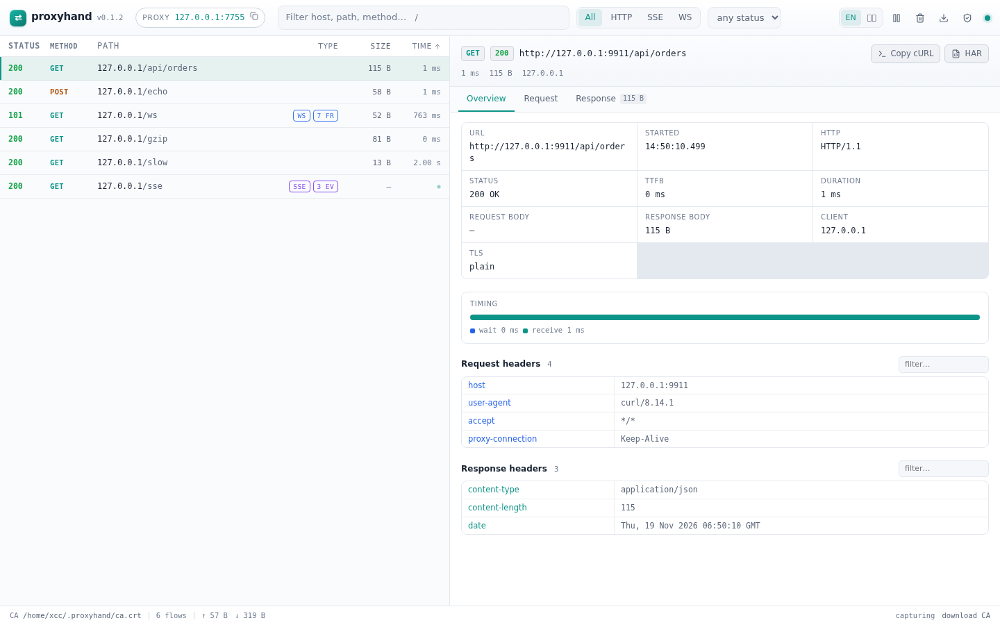
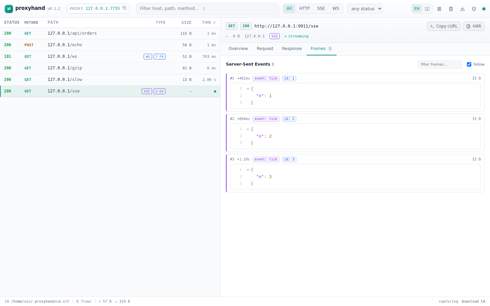
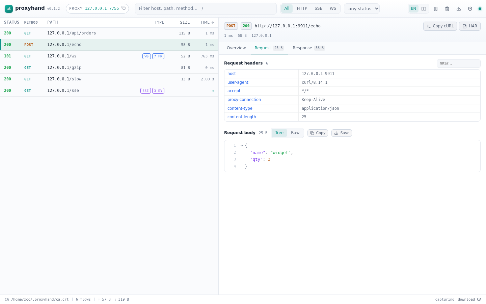
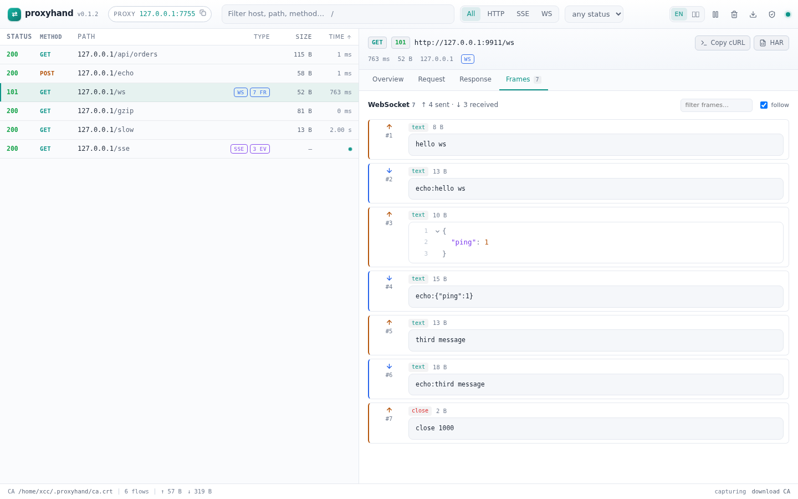
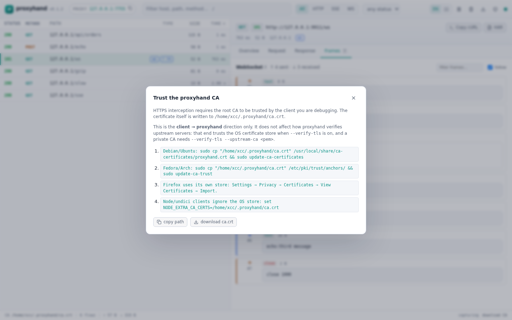

# proxyhand

**单二进制 HTTP/HTTPS/SSE/WebSocket 拦截代理，自带 Web UI。**

一个进程、一个端口同时服务 `http://` 和 `https://`，证书按需即时签发，还有一个轻量的查看器：
它把 SSE 事件和 WebSocket 帧实时推送出来，而不是等缓冲结束后再倒给你一整块数据。
用 Rust 编写，编译出来就是一个静态二进制，不需要额外安装运行时。

[](https://github.com/xiegoudan/proxyhand/releases/latest)
[](https://hub.docker.com/r/xiegoudan/proxyhand)
[](LICENSE)

```
┌───────────────┐   HTTP/HTTPS/WS   ┌────────────────────┐    ┌──────────────┐
│ browser / app │ ────────────────► │     proxyhand      │ ─► │   upstream   │
└───────────────┘      :7747        │  proxy + web UI    │    └──────────────┘
                                    │       :7747        │
                                    └────────────────────┘
                                            ▲
                    http://127.0.0.1:7747 ──┘   (same port: requests addressed to it are the UI)
```

简体中文 | [English](README.md)

### 截图

| | |
| --- | --- |
|  |  |
|  |  |

## 快速开始

```bash
git clone git@github.com:xiegoudan/proxyhand.git
cd proxyhand
cargo build --release
./target/release/proxyhand        # proxy + UI on http://127.0.0.1:7747
```

或者从源码安装：`cargo install --path .`。

Web UI 已经嵌进二进制里，没有别的东西要启动。打开
<http://127.0.0.1:7747> —— 代理自己就提供 UI，用的正是它做代理的那个端口。

预构建的前端产物（`web/dist/index.html`）已经提交进仓库，所以单纯 `cargo build` 出来的二进制就带 UI。
如果改了 `web/src/`，用 `pnpm build:web` 重新构建，下一次 `cargo build` 时 `build.rs` 会自动把它重新嵌入。

拿自带的示例目标试一下：

```bash
cargo run --release --example demo-target      # http://127.0.0.1:9911 with JSON, SSE and a WS echo
curl -x http://127.0.0.1:7747 http://127.0.0.1:9911/api/orders
curl -x http://127.0.0.1:7747 -N http://127.0.0.1:9911/sse
```

把客户端指向它：

```bash
export HTTP_PROXY=http://127.0.0.1:7747 HTTPS_PROXY=http://127.0.0.1:7747 NO_PROXY=localhost,127.0.0.1
curl -x http://127.0.0.1:7747 https://example.com
```

## 预编译二进制

每个 release 直接挂可执行文件本身，不用解压，名字统一是 `proxyhand-<架构>-<系统>`：
`amd64` 就是 x86-64（普通 Intel/AMD 电脑），`arm64` 是 64 位 ARM（Apple 芯片、Windows on ARM、ARM 服务器）。

| 平台 | 文件名 |
| --- | --- |
| Windows x64 | `proxyhand-amd64-windows.exe` |
| Windows on ARM | `proxyhand-arm64-windows.exe` |
| Linux x64，静态 | `proxyhand-amd64-linux` |
| Linux arm64，静态 | `proxyhand-arm64-linux` |
| macOS Apple 芯片 | `proxyhand-arm64-macos` |
| macOS Intel | `proxyhand-amd64-macos` |
| Debian / Ubuntu | `proxyhand-<version>-amd64.deb`、`proxyhand-<version>-arm64.deb` |
| Fedora / RHEL / openSUSE | `proxyhand-<version>-amd64.rpm`、`proxyhand-<version>-arm64.rpm` |

Linux 的二进制是静态链接的，同一个文件在哪家发行版上都能跑（包括 Alpine、老 glibc 和精简容器）。

```bash
curl -LO https://github.com/xiegoudan/proxyhand/releases/latest/download/proxyhand-amd64-linux
chmod +x proxyhand-amd64-linux
sudo mv proxyhand-amd64-linux /usr/local/bin/proxyhand

sudo dpkg -i proxyhand-0.1.0-amd64.deb            # Debian / Ubuntu
sudo rpm -U proxyhand-0.1.0-amd64.rpm             # Fedora / RHEL / openSUSE
```

发布由 `.github/workflows/release.yml` 在每次 `v*` tag 时执行，同时附带 `SHA256SUMS`。

## 信任 CA（HTTPS 需要）

根 CA 位于 `~/.proxyhand/ca.crt`（删掉该目录即可重新生成）。叶子证书按 SNI 主机名即时签发。
把 CA 装到客户端存放信任的地方：

| 平台 | 命令 |
| --- | --- |
| Windows（管理员） | `certutil -addstore -f "ROOT" ca.crt` |
| Debian/Ubuntu/WSL | `sudo cp ca.crt /usr/local/share/ca-certificates/proxyhand.crt && sudo update-ca-certificates` |
| Fedora/Arch | `sudo cp ca.crt /etc/pki/trust/anchors/ && sudo update-ca-trust` |
| macOS | `sudo security add-trusted-cert -d -r trustRoot -k /Library/Keychains/System.keychain ca.crt` |
| Firefox | 设置 → 隐私与安全 → 证书 → 证书颁发机构 → 导入 |
| Node.js | `NODE_EXTRA_CA_CERTS=~/.proxyhand/ca.crt`（undici/fetch 会忽略系统证书库） |
| curl | `--cacert ~/.proxyhand/ca.crt` 或 `-k` |

UI 工具栏里的盾牌按钮会显示同样的说明，外加一个下载链接（`/api/ca.crt`）：


`proxyhand --help`、启动横幅以及 `/api/trust` 都会带上这些说明，英文或中文都有。

### 信任的两个不同方向

这里最容易把人绊住，因为同一个词同时指代代理的两端：

- **你的客户端 → proxyhand** —— 上面那张表解决的就是这一段。装好 `ca.crt`，浏览器或应用才会接受
  proxyhand 即时签发的证书。至于 proxyhand 如何看待服务器，这跟它没有关系。
- **proxyhand → 上游服务器** —— 这是另一个问题，关乎*服务器*的证书（公司的 MITM 设备、自签名的开发主机……）。
  “上游证书未验证”的提示就是从这儿来的。

两端分开配置；把 proxyhand 自己的 CA 加进“受信任的根证书颁发机构”，只影响第一段。对第二段，
那条提示是诚实的：只有在确实尝试过验证、验证失败、并且请求以不安全的方式重试过之后它才出现 ——
而且它会点名具体的 TLS 错误，而不是给每个 HTTPS 流都贴个标签。

`--verify-tls` 信任浏览器所信任的东西：内置根证书**加上操作系统的证书库**（Windows ROOT、macOS
钥匙串、`/etc/ssl/certs`）。公司 CA 如果已经装进系统，就不需要额外参数。如果两边都没有这个 CA，就显式加上：

```bash
proxyhand --verify-tls --upstream-ca corp-root.pem --upstream-ca another.pem   # repeatable
proxyhand --verify-tls --no-system-ca --upstream-ca corp-root.pem              # only the bundled roots + these PEMs
```

关闭验证时（默认），不做任何检查，也不会有任何提示。

## 用法

```
proxyhand [options]

-p, --port <n>        proxy port (default 7747; HTTP, HTTPS and the web UI share it)
-h, --host <addr>     listen address (default 127.0.0.1; use 0.0.0.0 to capture a phone)
-d, --dir <path>      data dir for the root CA (default ~/.proxyhand)
    --no-ui           headless: proxy only, no web UI and no /api endpoints
    --verify-tls      verify upstream certificates (default: accept anything, debug-friendly);
                      also trusts the OS certificate store, like a browser
    --no-system-ca    with --verify-tls, use only the bundled roots (skip the OS store)
    --upstream-ca <p> PEM file with extra CA(s) trusted for upstream TLS; repeatable, additive to
                      the bundled roots and the OS store. Only matters with --verify-tls
    --max-flows <n>   flows kept in memory (default 3000, oldest finished evicted)
    --max-body <n>    bytes kept per body (default 8 MiB, after decompression)
    --self-hosts <l>  extra names that also mean "this proxy" (comma separated); the built-in list is
                      localhost, 127.0.0.1, ::1, 0.0.0.0, the hostname and the interface IPs
    --lang <en|zh>    UI/CLI language (default: PROXYHAND_LANG, then LANG/LC_ALL, then English)
-v, --verbose         log every request
-V, --version         print the version
    --help            print this help
```

### 一个端口包办一切

监听端口同时干三件事：普通 HTTP 代理（absolute-form 请求）、经 `CONNECT` + MITM 的 HTTPS，
以及 Web UI 本身。当请求的主机是本机地址之一、端口又是我们的端口时，就由 UI 来应答 ——
所以不管浏览器有没有指向代理，打开 <http://127.0.0.1:7747> 都能用，而且这些 UI 请求永远不会
出现在流列表里。某个别名主机名解析到本机但没被识别时，会带一个标记头转发一次，然后以 `508` 应答，
而不是陷入回环 —— 用 `--self-hosts` 把它加进去。

要抓手机，用 `--host 0.0.0.0` 启动，把设备的 WiFi 代理设为 `<machine-ip>:7747`，并在设备上安装 `ca.crt`。

### Docker

已发布到 Docker Hub，`linux/amd64` 和 `linux/arm64` 共用同一个 tag：

```bash
docker pull xiegoudan/proxyhand:latest
docker run --rm -p 8899:7747 -v proxyhand_data:/data xiegoudan/proxyhand:latest

docker build -t proxyhand .          # 或者自己构建
docker run --rm -p 8899:7747 -v proxyhand_data:/data proxyhand
```

容器内监听的是默认端口 **7747**，宿主端口随便映射 —— `-p 8899:7747` 可以沿用原来的地址。浏览器直接访问
代理时发的是普通路径请求，代理认得自己的主机名，所以 `-p 8900:7747` 也一样能打开面板。

根证书放在卷里（`/data/ca.crt`，重建容器不换 CA）。镜像内置了 `--self-hosts proxy`，所以容器里设
`HTTP_PROXY=http://proxy:7747` 时，仍能 `GET http://proxy:7747/api/ca.crt` 安装证书（否则会被环路保护挡成 `508`）。

如果 `--dir` 里已经有 `ca.crt` 和 `ca.key`，会直接沿用，不会重新生成根证书；私钥支持 PKCS#8 和 PKCS#1
（`RSA PRIVATE KEY`）等常见 PEM 编码。这样升级、重启都不会让已经信任该 CA 的客户端失效。

```bash
docker compose build proxy && docker compose up -d proxy   # 复用 proxyhand_data 卷
```

```yaml
proxy:
  build: { context: . }
  ports: ["8899:7747"]
  volumes: [proxyhand_data:/data]
```

## UI 能做什么

- **实时流列表**，含方法、状态、耗时、大小，以及 `SSE` / `WS` / `tunnel` 标记，外加过滤（文本、
  类型、状态）和键盘浏览（`↑` `↓` 上下走，`/` 搜索，`Esc` 取消选中）。
- **默认按时间顺序** —— 新流落在底部，只要你停在底部，列表就跟着它们走。点 **Time** 列头（或按 `o`）
  切换成最新优先；这个选择会被记住。
- **概览**：耗时（TTFB 与接收分别计）、字节数、ALPN、代理备注、两边的头表。
- **请求 / 响应**：头部可过滤，正文默认展开成带行号的 JSON 树（Yaak 风格：可折叠分支、语法着色、长值自动换行），
  也可切原始文本；一键复制整段正文，gzip/br/deflate 即时解压，二进制正文可下载，截断会被标注。
- **SSE**：逐条事件 —— `event:`、`id:`、`retry:`、注释、字节大小、到达偏移、JSON 负载树、
  跟随尾部开关、帧过滤。
- **WS**：两个方向用 `↑` / `↓` 交错排列，opcode（text/binary/ping/pong/close）、分片与截断
  标记、JSON 负载树。
- 任意流都能 **复制 cURL**，单个流或全部都能 **导出 HAR**，抓包可以 **暂停 / 清空**（清空只移除已结束的流，
  还在进行的 SSE / WebSocket 会保留）。
- 顶栏的 **English / 简体中文** 切换（`?lang=`），记在 `localStorage` 里。

## 工作原理

| 文件 | 职责 |
| --- | --- |
| `src/proxy.rs` | 一个 `TcpListener`；hyper 处理 absolute-form 请求和 `CONNECT`。靠首字节 `0x16` 判断走 MITM 还是裸隧道。TLS 由 rustls 加按 SNI 签发的叶子证书终结；ALPN 固定为 `http/1.1`。正文是分叉的：转发的字节原样不动，解析器只看副本。CONNECT 隧道交给 worker 任务，这样 service future 仍然是 `Send`。 |
| `src/ca.rs` | 根 CA（rcgen，ECDSA P-256）+ 按主机缓存的叶子证书，叶子有效期 397 天、带 `subjectAltName`（包含 IP SAN），以及各平台的信任安装说明。 |
| `src/tls.rs` | 上游客户端配置：一个做验证的（内置根证书 + 系统证书库 + `--upstream-ca`），以及一个 fail-open 的，用于关闭验证时或恰好一次失败尝试之后。 |
| `src/sse.rs` | 增量式 `text/event-stream` 解析器（`\r\n` / `\n` / `\r`、多行 `data:`、注释、`retry:`），外加一个 NDJSON 分行器。 |
| `src/ws.rs` | 被动的 RFC 6455 帧解析器：掩码、126/127 长度形式、续帧与关闭码。代理从不重新编码帧；两端拿到的是同一批字节。 |
| `src/store.rs` | 内存中的环形流队列（默认 3000）+ 一个广播通道；每个流的帧数组上限 20k。备注按结构化方式存储，渲染流时才本地化。 |
| `src/api.rs` | REST（`/api/state`、`/api/flows`、`/api/flows/:id`、`/api/pause`、`/api/export/har`、`/api/ca.crt`、`/api/trust`）+ `/ws` 推送通道 + 托管内嵌 UI。 |
| `src/har.rs` | HAR 1.2 导出（耗时、已解码的正文、二进制用 base64）。 |
| `src/util.rs` | 目标解析（absolute-form URI 与 `Host` 的取舍）、正文解码/截断、逐跳（hop-by-hop）处理。 |
| `web/` | React 19 + Vite 的 UI，用 `vite-plugin-singlefile` 打包；`build.rs` 把 `web/dist/index.html` 嵌进二进制。 |

设计说明：

- **Rust，单个二进制。** TLS 拦截需要一个按 SNI 取证书的钩子：rustls 正好给了这个，结果就是一个
  静态二进制，不用装任何运行时。只支持 HTTP/1.1 —— 调试代理绝大多数时候要的就是这个。
- **TLS 验证 fail-open。** 默认不验证上游证书（和 Charles/whistle 一样），自签名的开发服务器才能用；
  要强制就加 `--verify-tls`。验证失败会触发恰好一次不安全重试，并在流上留一条备注 ——
  绝不会悄悄地对每个请求降级，什么都没验证的时候也不会留任何备注。
- **没有 20 秒的正文计时器。** 一个 socket 超时没法同时照顾 JSON 调用和 SSE 流，所以头部单独设界
  （30 秒：连接、握手和响应头），正文另算。流不会因为安静就被回收；普通正文在闲置 120 秒后回收。
- **不做缓冲。** SSE 帧解析就发生在被转发的那些 chunk 上，所以长连接流是增量出现的，keep-alive
  也原样保留。响应压缩只对记录下来的副本解码。
- **内存有界。** 每一份抓取都有上限：每个正文 `--max-body`（截断会被标注，并保留丢弃的字节数）、
  每个流 20k 帧、总共 `--max-flows` 个流。

## 限制

- 仅 HTTP/1.1（ALPN 固定，h2 不被代理）。
- WebSocket 帧只观察、不可编辑；目前没有断点，也没有拦截/编辑/重放。
- `CONNECT` 上的非 TLS 流量按原样隧道转发，并记录为 `tunnel` 流（不做检查）。
- 不支持上游的 HTTP/2、HTTP/3 和 QUIC。
- 请求正文会在内存中缓冲，好让验证重试是安全的（上限：64 MiB）。

## 常见问题

- **Windows 上 `curl: (35) schannel: ... CRYPT_E_NO_REVOCATION_CHECK`。**
  Windows 自带的 curl 走 schannel，会强制检查证书的吊销状态。proxyhand 的拦截证书
  是即时签发的，链上没有可用的 CRL / OCSP 地址，schannel 因此报"无法确定是否吊销"——
  这跟信任无关（浏览器和 OpenSSL 系客户端都能正常校验，`openssl verify` 是 `OK`）。
  这是客户端的策略，不是信任失败：加上 `--ssl-no-revoke`，或改用 Git for Windows
  自带的 OpenSSL 版 curl。

  ```bash
  curl --ssl-no-revoke -x http://127.0.0.1:8899 https://example.com
  ```

  基于 schannel / .NET 的工具也有同样的开关，例如
  `[System.Net.ServicePointManager]::CheckCertificateRevocationList = $false`。

## 开发

```bash
cargo test                       # parsers, store, capture and full proxy end-to-end tests
cargo clippy --all-targets -- -D warnings
cargo fmt --all

pnpm install                     # web UI only (Node 22+, pnpm)
pnpm typecheck
pnpm build:web                   # rebuilds web/dist/index.html; cargo re-embeds it on the next build
```

做 UI 开发时，在跑着的代理旁边执行 `pnpm dev`（Vite 在 :5173，把 `/api` 和 `/ws` 代理到 :7747）。

```
src/      proxy, CA, parsers, store, API, i18n
web/src/  React UI (i18n dictionaries in web/src/i18n.tsx)
tests/    integration tests (spawn the library in-process, no external services)
docs/     screenshots used by this README
```

## 安全

这是个调试工具，原理就是做 TLS 拦截：它能看见你指向它的那些客户端的每一个头、正文、cookie 和
token。除非你确实需要抓局域网，否则就让它绑在 `127.0.0.1`；用完之后，把根 CA 从信任库里删掉。
`~/.proxyhand/ca.key` 以 `0600` 权限写入。

## 许可证

Apache License, Version 2.0 —— 见 [LICENSE](LICENSE)。
